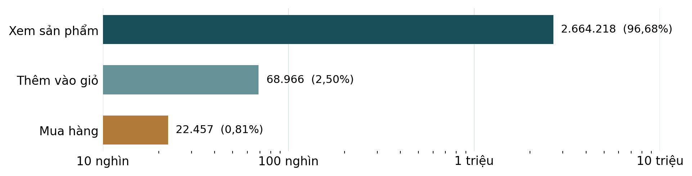

# BÁO CÁO XỬ LÝ DỮ LIỆU RETAILROCKET

**Đề tài:** Hệ thống gợi ý sản phẩm cá nhân hóa dựa trên tương tác đa hành vi trong thương mại điện tử.

**Sinh viên:** Vũ Hải Minh — MSSV: 20235166. **Ngày cập nhật:** 22/10/2026.

## 1. Phạm vi và hiện trạng project

Project hiện dừng tại **hoàn tất xử lý và kiểm tra dữ liệu**. Nội dung báo cáo gồm đánh giá dữ liệu gốc, các công đoạn đã thực hiện, mục đích từng bước, bảng đầu ra và giới hạn dữ liệu. Phần mô hình, phương pháp gợi ý, huấn luyện, kết quả thực nghiệm và demo đã được gỡ khỏi project.

Pipeline chính là scripts/prepare_multibehavior.py; cấu hình là configs/multibehavior.json. CSV gốc, dữ liệu đã xử lý, manifest và các báo cáo kiểm tra dữ liệu được giữ nguyên. Nhãn, mẫu âm và các tập train/validation/test vẫn thuộc bộ chuẩn bị dữ liệu; việc có các bảng này không đồng nghĩa đã huấn luyện mô hình.

## 2. Dữ liệu gốc và đánh giá chất lượng

### 2.1. Thành phần dữ liệu

| Tệp | Số dòng | Nội dung |
|---|---:|---|
| events.csv | 2.756.101 | Sự kiện gồm timestamp, visitorid, event, itemid, transactionid. |
| item_properties_part1.csv | 10.999.999 | Bản ghi thuộc tính sản phẩm theo thời gian, phần 1. |
| item_properties_part2.csv | 9.275.903 | Phần 2 của cùng nguồn thuộc tính. |
| category_tree.csv | 1.669 | Danh mục và quan hệ danh mục cha. |

Tệp sự kiện có 1.407.580 visitor, 235.061 item; thời gian từ 03/05/2015 đến 18/09/2015 UTC. Hai phần thuộc tính có tổng 20.275.902 dòng, 417.053 item và 1.104 loại thuộc tính. Số item ở log và ở thuộc tính khác nhau; phải phân biệt các tập này khi nối dữ liệu.

### 2.2. Các vấn đề cần xử lý

| Đặc điểm | Quan sát | Ý nghĩa khi chuẩn bị dữ liệu |
|---|---|---|
| Trường bắt buộc đầy đủ | Không thiếu timestamp, visitorid, event hoặc itemid. | Không cần điền giá trị giả; vẫn kiểm tra để nhận diện đầu vào khác phiên bản. |
| Dòng trùng | Có 460 bản sao hoàn toàn, khoảng 0,0167% raw. | Loại bản sao để tránh tăng giả số đếm; giữ lượt lặp có timestamp khác. |
| transactionid thiếu có ý nghĩa | 2.733.644 dòng không phải mua không có mã giao dịch. | Không xóa các dòng này; không sinh mã giao dịch giả cho xem/giỏ. |
| Lệch hành vi | Lượt xem áp đảo; mua chỉ khoảng 0,81% sự kiện sạch. | Giữ ba hành vi riêng để không làm mất loại tín hiệu. |
| Lịch sử ngắn và thưa | 71,16% visitor chỉ có một sự kiện; 79,53% chỉ tương tác một item. | Không mặc định mọi visitor có lịch sử dài; không lọc bỏ toàn bộ nhóm ít tương tác. |
| Metadata không đầy đủ | 49.815 item có tương tác không có thuộc tính ở bất kỳ thời điểm nào. | Giữ cờ unknown, không loại sạch mọi item thiếu thông tin. |
| Metadata thay đổi | Category và available có timestamp cập nhật. | Tra đúng trạng thái đã biết tại thời điểm query, không lấy tương lai để lấp thiếu. |
| Log quan sát có giới hạn | Không có đầy đủ exposure logs, rating hoặc phản hồi không thích. | Chưa mua không có nghĩa là không thích; không suy ra doanh thu hoặc tác động kinh doanh. |

22.457 dòng transaction tương ứng 17.672 mã giao dịch khác nhau, không phải 22.457 đơn hàng. Visitor là định danh truy cập ẩn danh, không xác nhận một người dùng trên nhiều thiết bị.

Không ép mọi lượt mua đi qua đầy đủ chuỗi xem → giỏ → mua. Audit ghi nhận chỉ 18.030/22.457 dòng mua có cả xem và giỏ trước đó trên cùng cặp visitor–item; không sinh thêm sự kiện giả để bù chuỗi thiếu.

## 3. Các công đoạn đã hoàn thành và mục đích

### 3.1. Đọc và kiểm tra đầu vào

**Đã xử lý:** đọc bốn CSV, kiểm tra tên cột, loại hành vi, trường bắt buộc và khóa danh mục. Hai file thuộc tính được đọc theo khối 1.000.000 dòng; ghi checksum SHA-256 đầu vào.

**Mục đích:** đọc đầy đủ hơn 20 triệu bản ghi với bộ nhớ phù hợp, phát hiện sai nguồn/sai phiên bản và tạo căn cứ tái lập. Chia khối là cách đọc toàn bộ file, không phải lấy mẫu bỏ bớt dữ liệu.

### 3.2. Làm sạch log và bảo toàn hành vi

**Đã xử lý:** chỉ chấp nhận view, addtocart, transaction; loại thiếu bốn trường chính và trùng hoàn toàn theo năm cột raw. Bản dữ liệu này không có trường chính thiếu hoặc hành vi ngoài tập hợp lệ; 460 dòng bị loại đều là bản sao: 94 view và 366 addtocart.

**Mục đích:** tránh đếm đôi nhưng vẫn giữ các lần tương tác thực sự khác nhau. Sau làm sạch còn 2.755.641 sự kiện: 2.664.218 view, 68.966 addtocart, 22.457 transaction. Chưa lọc bot hoặc áp ngưỡng tương tác tối thiểu; không tự kết luận visitor hoạt động nhiều là bất thường.

### 3.3. Chuẩn hóa thời gian và thứ tự lưu

**Đã xử lý:** chuyển timestamp millisecond thành UTC; thêm event_id từ vị trí dòng raw; sắp theo visitorid, event_time, event_id. Các sự kiện cùng timestamp được quan sát cùng nhóm.

**Mục đích:** thống nhất phép tính khoảng nghỉ, history và cửa sổ thời gian. event_id hỗ trợ tái lập thứ tự lưu, không thể hiện quan hệ nhân quả giữa sự kiện đồng thời.

### 3.4. Tạo session

**Đã xử lý:** session mới bắt đầu khi visitor thay đổi hoặc cùng visitor nghỉ hơn 30 phút. Toàn kỳ có 1.761.675 session trước khi loại ranh giới và cửa sổ nhãn.

**Mục đích:** tạo đơn vị phiên truy cập có quy tắc rõ ràng, không yêu cầu mỗi session phải có ít nhất hai item. Khoảng nghỉ 30 phút là quy ước xử lý, không phải thông tin session sẵn có trong raw.

### 3.5. Chia tập theo thời gian và xử lý session qua ranh giới

**Đã xử lý:** lấy phân vị 80%/90% thời gian sự kiện sạch, làm tròn millisecond. Train kết thúc 18/08/2015 04:23:20.445 UTC; validation kết thúc 02/09/2015 17:49:14.032 UTC; quan sát kết thúc 18/09/2015 02:59:47.788 UTC. Gắn boundary_drop cho 47 session, 328 sự kiện băng mốc.

**Mục đích:** phân biệt quá khứ và giai đoạn sau, hạn chế trộn thông tin thời gian. Boundary vẫn được lưu trong events để kiểm kê nhưng không tham gia history/label. Quy tắc này sử dụng thời điểm kết thúc session để chọn mẫu ngoại tuyến, cần công bố khi dùng dữ liệu.

### 3.6. Tạo query

**Đã xử lý:** một query cho mỗi session không qua ranh giới, sau khi quan sát toàn bộ nhóm sự kiện có timestamp đầu tiên; query_id bằng session_id.

**Mục đích:** xác định một mốc quan sát t thống nhất để lấy history và nhãn. Không chọn query theo việc visitor sẽ mua hoặc số item cuối session. Visitor ngoài train vẫn có thể có history vừa quan sát tại query.

### 3.7. Tạo nhãn mua 7 ngày và lưu mẫu thiếu cửa sổ

**Đã xử lý:** target là item có transaction của cùng visitor và split trong khoảng (t, t+7 ngày], loại boundary. Item mua lặp chỉ tạo một cặp query–item, kèm purchase_event_count. Query phải có đủ cửa sổ trong split; 242.601 query không đủ được lưu riêng vào excluded_queries.

**Mục đích:** không nhầm nhãn mua tương lai với hành vi tại query, không gán âm giả vì thiếu thời gian quan sát. Query đủ cửa sổ nhưng không mua vẫn được giữ. Các query có thể chia sẻ giao dịch vì cửa sổ chồng nhau; số cặp target không phải số đơn hàng mới được sinh thêm.

### 3.8. Tạo history và đặc trưng query

**Đã xử lý:** history chỉ gồm sự kiện cùng visitor có event_time ≤ t, loại boundary. Tạo số đếm từng hành vi toàn lịch sử, trong 7/30 ngày, thời điểm gần nhất, recency theo giờ và cờ có lịch sử hành vi. Cửa sổ W dùng (t−W, t].

**Mục đích:** biểu diễn lịch sử bằng thông tin đã quan sát. Nhãn và các cột target_count, label_end, has_purchase_target, eligible_target_count được tách khỏi query_features. Recency thiếu nghĩa là chưa từng có hành vi; điền 0 sẽ nhầm thành vừa thực hiện.

### 3.9. Tổng hợp cặp visitor–item và cạnh từng hành vi

**Đã xử lý:** chỉ tổng hợp sự kiện train thành 1.713.144 cặp visitor–item và 1.769.390 cạnh visitor–item–behavior. Lưu số đếm, thời điểm cuối và recency. Điểm quy ước: r = ln(1+view) + 3×ln(1+addtocart) + 5×ln(1+transaction).

**Mục đích:** có các biểu diễn tổng hợp và vẫn giữ riêng loại hành vi. Log giảm ảnh hưởng của lượt lặp nhiều; 1–3–5 là quy ước cấu hình, không phải xác suất mua. Bảng tổng hợp ở cuối train không được ghép nguyên làm feature của một query sớm hơn cutoff.

### 3.10. Mã hóa ID chỉ từ train

**Đã xử lý:** mapping cho 1.123.755 visitor và 212.915 item có tương tác train; PAD=0, UNK=1, ID đã biết bắt đầu từ 2. ID raw được giữ; query/target có cờ cold_user/cold_item.

**Mục đích:** không lấy vocabulary tương lai, phân biệt đối tượng ngoài train. Các item mới cùng có chỉ số UNK vẫn là các item khác nhau theo raw ID; không gộp chúng thành một sản phẩm.

### 3.11. Xử lý metadata và cây danh mục

**Đã xử lý:** giữ categoryid/available trong bộ làm việc, gồm 2.291.853 bản ghi; các thuộc tính khác vẫn còn ở raw. Kiểm tra khóa item–property–timestamp và available 0/1; lưu property_time, valid_to. Tính root/depth/path của cây danh mục, kiểm tra cha và chu trình.

**Mục đích:** giảm kích thước bộ làm việc, giữ thuộc tính diễn giải được và tra trạng thái gần nhất không muộn hơn t. Category thiếu/ngoài cây nhận −1 với cờ riêng; available thiếu giữ NA/unknown; parent rỗng của root hợp lệ.

### 3.12. Dựng catalog và mẫu âm đúng thời điểm

**Đã xử lý:** catalog toàn kỳ có 466.868 item. known_at là lần đầu item xuất hiện trong log hoặc category/available. Candidate có known_at ≤ t và available gần nhất khác 0; unknown được giữ. Mỗi query train có mua nhận tối đa 5 item âm từ vocabulary train, đủ điều kiện tại t và không trùng target: tổng 91.540 cặp.

**Mục đích:** tránh item hoặc thuộc tính từ tương lai, giữ nhãn ngoài candidate để phân tích độ phủ thực. Âm chỉ là không quan sát mua trong cửa sổ, không phải bằng chứng không thích. Catalog toàn kỳ và snapshot cuối train không thay được trạng thái từng query. Những bảng này được giữ như dữ liệu đã chuẩn bị.

### 3.13. Lưu và xác minh đầu ra

**Đã xử lý:** lưu 20 tệp Parquet, schema, số dòng, cấu hình, phiên bản và checksum. Marker INCOMPLETE được dùng khi đang xử lý. Giữ kiểm tra trùng, bảo toàn hành vi, thời gian, mapping, metadata, nhãn và mẫu âm.

**Mục đích:** phát hiện dữ liệu thiếu hoặc sai phiên bản và tái lập từ raw. Lần tạo 29/09/2026 ghi 29 kiểm tra đạt; lần rà soát 01/10 ghi 51/51 kiểm tra và 11/11 unit tests, có kiểm tra độc lập bổ sung trên 240 query. Đây là kết quả lịch sử; dùng lệnh xác minh hiện tại để đối chiếu bộ dữ liệu đang có.

## 4. Kết quả theo từng tập

| Chỉ tiêu | Train | Validation | Test |
|---|---:|---:|---:|
| Sự kiện, không gồm boundary | 2.204.470 | 275.359 | 275.484 |
| Query đủ cửa sổ | 1.312.772 | 99.873 | 106.382 |
| Query có nhãn mua | 18.308 | 1.553 | 1.465 |
| Query không có nhãn mua | 1.294.464 | 98.320 | 104.917 |
| Cặp query–item nhãn mua | 73.969 | 8.250 | 6.098 |
| Query loại vì thiếu cửa sổ | 83.501 | 82.661 | 76.439 |
| Query thuộc visitor ngoài train | 0,00% | 85,33% | 90,05% |
| Cặp target có item ngoài train | 0,00% | 1,13% | 8,99% |
| Độ phủ target theo cặp | 89,73% | 88,40% | 88,91% |

Tổng cộng 1.519.027 query và 88.317 cặp target. Query không có tỷ lệ 80/10/10 do loại ranh giới và cửa sổ nhãn chưa đủ. Test có khoảng 1,38% query có mua; đây không phải conversion rate của một hệ thống đang vận hành.

## 5. Các bảng đầu ra và cách sử dụng

| Nhóm bảng | Nội dung và lưu ý |
|---|---|
| events | Sự kiện sạch, timestamp, session, split và raw/encoded ID; loại boundary khi lấy history. |
| queries, splits/*_queries | Một dòng/query đủ cửa sổ; giữ cờ và thông tin kiểm tra nhãn riêng khỏi feature. |
| purchase_targets, splits/*_targets | Một dòng/query–item được mua; không phải catalog hoặc feature lịch sử. |
| query_features | Thống kê history tại query, tách khỏi nhãn tương lai. |
| interactions_train, behavior_edges_train | Tổng hợp cuối train theo cặp và theo từng hành vi. |
| user_mapping, item_mapping | Vocabulary train; không trộn với mapping của pipeline notebook cũ. |
| property_history, category_tree | Lịch sử thuộc tính và phân cấp danh mục. |
| catalog, products_train_snapshot | Item toàn kỳ với known_at; snapshot chỉ đúng cuối train. |
| excluded_queries | Query thiếu cửa sổ quan sát, không được gán âm giả. |
| negative_samples_train | Mẫu không mua được lấy theo quy tắc train và candidate tại query. |

Các bảng nằm ở data/multibehavior/. data/processed/, data/interim/ và data/splits/ thuộc pipeline next-item notebook cũ, được giữ riêng. Bộ cũ và bộ hiện tại có nhãn, đơn vị mẫu và mapping khác nhau; không dùng lẫn.

## 6. Giới hạn còn lại và tiêu chí hoàn thành

Trong item có tương tác train, 20,96% chưa biết category và 20,84% chưa biết availability tại cuối train. Dữ liệu rất thưa, nhiều visitor mới và lịch sử ngắn. Làm sạch không tự khôi phục được metadata thiếu hoặc biến mẫu âm thành phản hồi không thích chắc chắn.

Độ phủ target test theo cặp 88,91% chỉ phản ánh nhãn có nằm trong candidate hay không; không phải kết quả xếp hạng. Cửa sổ nhãn chồng nhau làm query cùng visitor có thể phụ thuộc. Việc loại session qua ranh giới là quy tắc chọn mẫu ngoại tuyến.

Giai đoạn dữ liệu hoàn thành khi các tệp đủ, khớp manifest, không có marker INCOMPLETE, bảo toàn số hành vi, history/metadata không từ tương lai, nhãn đúng cửa sổ, mapping chỉ từ train và mẫu âm đúng quy tắc. Project hiện chỉ giữ phạm vi này.

## 7. Kiểm tra và tài liệu đối chiếu

**Kiểm tra fixture:** `python -m unittest discover -s tests -v`.

**Kiểm tra dữ liệu thật:** `python scripts/verify_artifacts.py`.

**Chỉ tái tạo khi cần:** `python scripts/prepare_multibehavior.py`; lệnh sẽ ghi lại các đầu ra do pipeline quản lý. Không cần chạy lại chỉ để đọc dữ liệu đã khớp manifest.

**Nguồn số liệu:** data/README.md; reports/data_raw_metrics.json; reports/raw_analysis/metrics.json; reports/multibehavior/summary.json, manifest.json, REVIEW_VI.md và recheck_2026-10-01.json. Định nghĩa dữ liệu được đối chiếu với docs/DATA_PROTOCOL.md, docs/DATA_DICTIONARY.md và mã pipeline hiện tại.
