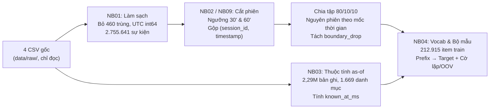

# Dữ liệu, Tiền xử lý và Giao thức Chống rò rỉ (RetailRocket)

Tài liệu này mô tả chuẩn mực toàn bộ nguồn dữ liệu, đặc điểm phân bố, quy trình tiền xử lý, đặc tả đầu vào – đầu ra và hệ thống kiểm định toàn vẹn của đề tài **Gợi ý sản phẩm theo phiên từ tương tác đa hành vi trên sàn thương mại điện tử** theo giao thức đã chốt trong [`configs/protocol.json`](../configs/protocol.json) (**phiên bản `v1.3.2`**, cập nhật `27/11/2026`).

- Tài liệu phương pháp & công thức mô hình: [`Phương pháp.md`](<Phương pháp.md>)
- Tài liệu giao thức đánh giá & kết quả thực nghiệm: [`Đánh giá.md`](<Đánh giá.md>)

---

## 1. Tổng quan nguồn dữ liệu gốc (`data/raw/`)

Đề tài sử dụng bộ log thương mại điện tử công khai **RetailRocket E-commerce Dataset** (Kaggle: `retailrocket/ecommerce-dataset`), ghi nhận tương tác ẩn danh của khách truy cập trong khoảng thời gian từ **`2015-05-03 03:00:04 UTC`** đến **`2015-09-18 02:59:47 UTC`** (~4,5 tháng). Toàn bộ tệp trong `data/raw/` là **chỉ đọc** và được kiểm tra mã băm SHA-256 trước mọi bước chạy.

| Nhóm dữ liệu | Tệp gốc (`data/raw/`) | Số dòng | Dung lượng (byte) | Trường thông tin chính | SHA-256 xác thực |
| --- | --- | ---: | ---: | --- | --- |
| Tương tác người dùng | `events.csv` | 2.756.101 | 94.237.913 | `timestamp`, `visitorid`, `event`, `itemid`, `transactionid` | `3745aa83238b1e6d44d8fda209807899f420084398f94ddf745f3cbcfecbf9e7` |
| Thuộc tính sản phẩm (phần 1) | `item_properties_part1.csv` | 10.999.999 | 484.315.749 | `timestamp`, `itemid`, `property`, `value` | `30aad5aeca58b2dc27dcc73e1708565f5818e45adb3eb57401f91e87355b0b81` |
| Thuộc tính sản phẩm (phần 2) | `item_properties_part2.csv` | 9.275.903 | 408.929.907 | `timestamp`, `itemid`, `property`, `value` | `d5e7d1a91dc40f522aeb596b267e6c87d8aed689a7192d12369cfb165eb987e5` |
| Cây danh mục sản phẩm | `category_tree.csv` | 1.669 | 14.454 | `categoryid`, `parentid` | `94e865eb0a3d48cbbfe3b79079018dd92509315c88f5fd8d00d0b4b5af434f5b` |

### Cấu trúc lưu trữ thư mục `data/`

Dữ liệu nhị phân (`.csv`, `.parquet`) không đưa lên Git do kích thước lớn; chỉ lưu tệp cấu hình `data/processed/split_config.json`. Toàn bộ dữ liệu xử lý được tái lập hoàn toàn bằng chuỗi notebook `01` → `04`, `09` và `10`.

```text
data/
├── raw/                                  # 4 tệp CSV gốc từ Kaggle (chỉ đọc)
└── processed/                            # Dữ liệu Parquet & JSON đã xác minh
    ├── events_clean.parquet              # Sự kiện sạch, bỏ 460 dòng trùng, UTC int64 ms (NB01)
    ├── events_sessionized.parquet        # Sự kiện gắn session_id, group_index, split 30' (NB02)
    ├── sessions.parquet                  # Bảng tóm tắt 1.761.675 phiên 30' (NB02)
    ├── timestamp_groups.parquet          # Bảng 2.753.015 nhóm (session_id, timestamp) (NB02)
    ├── splits/                           # 4 phân vùng: train, validation, test, boundary_drop (NB02)
    ├── split_config.json                 # Mốc chia thời gian & quy tắc cắt phiên 30' (NB02)
    ├── item_property_history.parquet     # 2.291.853 bản ghi cập nhật categoryid & available (NB03)
    ├── category_tree.parquet             # 1.669 danh mục kèm cờ is_root (NB03)
    ├── item_catalog.parquet              # 466.868 item với known_at_ms & has_metadata (NB03)
    ├── item_vocab.parquet                # Vocabulary 212.915 item từ train (NB04)
    ├── samples/                          # {train,validation,test}_{queries,targets}.parquet 30' (NB04)
    ├── session60/                        # Bản tương ứng cho ngưỡng phiên 60 phút (NB09)
    └── final/                            # Top-K và điểm từng query của lần chạy Test cuối (NB10)
```

---

## 2. Đặc trưng dữ liệu và kết quả khảo sát chất lượng

### 2.1. Phân bố 3 hành vi tương tác (`reports/01_events_clean/metrics.json`)

Log chứa **1.407.580 visitor** và **235.061 item** phân biệt trong `events.csv`. Sau khi loại bỏ **460 dòng trùng tuyệt đối trên đủ 5 cột gốc** (**94 `view`** và **366 `addtocart`**, `0` dòng `transaction`), còn lại **2.755.641 sự kiện sạch**:

| Hành vi (`event`) | Số sự kiện sạch | Tỷ trọng | Ý nghĩa tín hiệu |
| --- | ---: | ---: | --- |
| `view` (xem sản phẩm) | 2.664.218 | 96,68% | Phản hồi ngầm yếu nhưng chiếm áp đảo khối lượng log |
| `addtocart` (thêm giỏ hàng) | 68.966 | 2,50% | Ý định mua rõ rệt; xuất hiện hiếm (~1/39 lượt xem) |
| `transaction` (mua hàng) | 22.457 | 0,81% | Tín hiệu ý định mạnh nhất; luôn đi kèm `transactionid` |
| **Tổng cộng** | **2.755.641** | **100,00%** | Không có vi phạm schema (`schema_violations = 0`) |

### 2.2. Kết quả kiểm tra chất lượng và các bất thường cần xử lý

| Hạng mục khảo sát | Kết quả đo thực tế (`NB01`–`NB03`) | Cách xử lý chuẩn mực trong pipeline |
| --- | --- | --- |
| Schema & giá trị hợp lệ | `0` thiếu ở 4 cột bắt buộc; `0` nhãn/ID/timestamp sai; `0` giao dịch thiếu `transactionid`; `0` `view`/`addtocart` có `transactionid` | Giữ kiểm tra `assert` tự động trong NB01 |
| Thiếu `transactionid` | **2.733.644** dòng raw thiếu `transactionid` (đều là `view`/`addtocart` hợp lệ) | Tuyệt đối không dùng `dropna()` trên toàn bảng |
| Bản ghi thuộc tính | **20.275.902** dòng xuyên 2 phần (`0` trùng tuyệt đối giữa 2 phần); lọc giữ **2.291.853** bản ghi (`1.503.639` `available` + `788.214` `categoryid`), `0` xung đột cùng `(item, property, timestamp)` | Đọc theo khối (`chunksize`), sắp theo `(itemid, timestamp)` và lưu `item_property_history.parquet` |
| Lệch cửa sổ thời gian thuộc tính | `events`: `03/05–18/09/2015`; `properties`: `10/05–13/09/2015` (UTC). Có **137.193** sự kiện xảy ra trước mốc thuộc tính đầu tiên và **393.155** sự kiện trước bản ghi thuộc tính đầu tiên của chính item đó | Chỉ thực hiện `merge_asof(..., direction="backward")` tại `timestamp <= t`; thiếu để `unknown`, **không điền ngược từ tương lai** |
| Độ phủ metadata sản phẩm | Tổng catalog **466.868** item (`235.061` có trong events, `231.807` chỉ có trong properties); **49.815 / 235.061** item trong events (`21,19%`) không có metadata | Giữ nguyên toàn bộ item trong events; gắn cờ `has_metadata = False` |
| Cây danh mục | **1.669** danh mục, **25** danh mục gốc, độ sâu tối đa **5**, `0` trùng ID, `0` chu trình, `0` cha ngoài cây. Có **30** mã danh mục ngoài cây thuộc **137** item, nhưng **`0` item** xuất hiện trong events | Giữ giá trị `NULL` cho `parentid` của 25 gốc (không điền `0`) |
| Thứ tự toàn cục | Cả `events.csv` và hai tệp thuộc tính đều **không sắp sẵn** theo thời gian | Bắt buộc sắp ổn định theo khóa thời gian trước khi cắt phiên hoặc tra cứu as-of |

### 2.3. Năm đặc điểm dữ liệu chi phối trực tiếp thiết kế hệ thống

1. **Độ thưa cực lớn:** Mật độ ma trận cặp `(visitor, item)` xấp xỉ **0,00065%** (sparsity ≈ **99,99935%**). **71,16%** visitor chỉ có đúng 1 sự kiện và **79,53%** visitor chỉ tương tác đúng 1 sản phẩm → không thể dựa vào hồ sơ người dùng dài hạn; phải tập trung vào **ngữ cảnh phiên (session-based)** kèm cơ chế dự phòng (fallback).
2. **Phản hồi ngầm (Implicit Feedback):** Không có đánh giá sao và không có log hiển thị (*exposure*), nên không thể coi sản phẩm chưa được tương tác là nhãn âm thật.
3. **Ẩn danh nội dung:** Không có tên, ảnh hay mô tả sản phẩm; thông tin phụ chỉ có `categoryid` và `available` thay đổi theo thời gian.
4. **Tương tác lặp cao trong phiên (`reports/04_samples/`):** **41,01%** lượt item trong target `train` đã xuất hiện trước đó trong chính tiền tố phiên (và `94.157` phiên train đủ mẫu chỉ chứa đúng 1 item phân biệt, theo khảo sát ban đầu). Điều này đòi hỏi tách đánh giá **Target mới vs Target lặp** và thêm mốc **Repeat-last** (Quyết định **D1**).
5. **Trôi dạt danh mục theo thời gian (Cold-start Item):** Tỷ lệ lượt target ngoài vocabulary `train` đạt **5,31%** ở `validation` và **9,33%** ở `test` → cần cơ chế `train_validation_refit` (**D2**) và giữ nguyên OOV trong mẫu số đánh giá để không làm đẹp số liệu giả tạo.

---

## 3. Pipeline tiền xử lý dữ liệu và chống rò rỉ (`NB01`–`NB04`, `NB09`)



### 3.1. Luật cắt phiên và gom nhóm đồng thời (`timestamp_group`)

- **Luật tạo phiên mới:** Khởi tạo phiên mới khi đổi `visitorid` **hoặc** khoảng nghỉ giữa hai sự kiện liên tiếp lớn hơn ngưỡng $\Delta_{\max}$:
  - **Giao thức chuẩn (NB02):** $\Delta_{\max} = 1.800.000\text{ ms}$ (**30 phút**; nghỉ đúng 30 phút vẫn thuộc cùng phiên). Tạo ra **1.761.675 phiên** và **2.753.015 nhóm timestamp**.
  - **Biến thể so sánh (NB09):** $\Delta_{\max} = 3.600.000\text{ ms}$ (**60 phút**) theo đúng cùng luật và cùng mốc chia thời gian. Tạo ra **1.726.714 phiên** (giảm số phiên đơn lẻ, tăng tỷ lệ cặp `addtocart → transaction` nằm cùng phiên từ **89,90%** lên **92,89%**).
- **Nhóm timestamp = `(session_id, timestamp)`:** Trong dữ liệu sạch (phiên 30') có **2.143 nhóm** chứa nhiều hơn 1 sự kiện (**2.132 nhóm** có nhiều item, **12 nhóm** có nhiều hành vi). Toàn bộ sự kiện cùng `(session_id, timestamp)` được gộp vào đúng một bước $g_t$, **tuyệt đối không tự đặt thứ tự giả** giữa các sự kiện đồng thời.

### 3.2. Chia tập theo thời gian và loại bỏ rò rỉ biên (`data/processed/split_config.json`)

Hai mốc cắt thời gian được tính theo phân vị `0,8` và `0,9` (nội suy tuyến tính, cắt xuống mili-giây nguyên) trên toàn bộ timestamp sự kiện sạch **trước khi loại phiên biên**:

- **`cut80`:** `1439871800445 ms` (`2015-08-18 04:23:20.445 UTC`)
- **`cut90`:** `1441216154032 ms` (`2015-09-02 17:49:14.032 UTC`)

Đơn vị chia là **nguyên phiên** nhằm tránh cắt đôi hành vi của cùng một lần truy cập:
- **`train`:** `session_end <= cut80`
- **`validation`:** `session_start > cut80` và `session_end <= cut90`
- **`test`:** `session_start > cut90`
- **`boundary_drop`:** mọi phiên có `session_start <= cutoff < session_end`. Tập này **không bao giờ** được dùng làm lịch sử, nguồn ứng viên hay nhãn đánh giá.

| Phân vùng | Phiên (30') | Sự kiện (30') | Nhóm (30') | Query (30') | Phiên (60') | Query (60') | Target lặp (30') | OOV target (30') |
| --- | ---: | ---: | ---: | ---: | ---: | ---: | ---: | ---: |
| **Train (80%)** | 1.396.273 | 2.204.470 | 2.202.298 | **806.025** | 1.368.507 | **833.781** | 41,01% | 0,00% |
| **Validation (10%)** | 182.534 | 275.359 | 275.100 | **92.566** | 178.854 | **96.148** | 42,17% | 5,31% |
| **Test (10%)** | 182.821 | 275.484 | 275.289 | **92.468** | 179.284 | **95.783** | 40,18% | 9,33% |
| **`boundary_drop`** | 47 | 328 | 328 | 281 *(bỏ)* | 69 | 589 *(bỏ)* | — | — |

*(Phân bố độ dài prefix trên Validation 30' — `92.566` query: nhóm `1` có `38.290` [41,4%], `2–4` có `31.138` [33,6%], `5–9` có `11.981` [12,9%], `10+` có `11.157` [12,1%]. Trên Test 30' — `92.468` query: `1` có `37.864`, `2–4` có `30.962`, `5–9` có `11.778`, `10+` có `11.864`.)*

---

## 4. Đặc tả Đầu vào – Đầu ra (Input / Output), Vocabulary và Lọc ứng viên

### 4.1. Định nghĩa mẫu `prefix → target` (NB04)

Một phiên có $n \ge 2$ nhóm timestamp $(g_1, g_2, \dots, g_n)$ sinh ra $n - 1$ truy vấn (phiên 1 nhóm không tạo query, nhưng vẫn được giữ trong tập sự kiện train để xây vocabulary và popularity). Tại vị trí $t \in \{1, \dots, n - 1\}$:

- **Input (Tiền tố phiên $P_q$):** Chuỗi các nhóm đã quan sát $P_q = (g_1, \dots, g_t)$ gồm `(itemid, event, timestamp)` và mốc thời gian truy vấn $t = \text{timestamp}(g_t)$. Để tránh nhân bản dữ liệu, prefix không lưu trùng mà đọc trực tiếp từ `events_sessionized` theo `(session_id, group_index <= prefix_len_groups)`.
- **Target ($G_q$):** Tập hợp các `itemid` phân biệt xuất hiện trong nhóm kế tiếp $g_{t+1}$ (mọi loại hành vi). Giữ nguyên **ID gốc**, kể cả item ngoài vocabulary.
  - *Ví dụ:* `g₁ = xem A`, `g₂ = xem B`, `g₃ = thêm giỏ B + xem C` (cùng timestamp) → tại cuối `g₂`, target là $G_q = \{B, C\}$. (Có `1.519` / `177` / `140` query có $|G_q| > 1$ lần lượt ở train / validation / test 30'.)
- **Output (Danh sách gợi ý $L_q$):** Danh sách đúng $K = 20$ sản phẩm **không trùng**, sắp theo điểm giảm dần (từ `NB11` demo: `rank, item_id, score, category_id, is_fallback`).

### 4.2. Vocabulary và độ phủ tín hiệu học (`reports/04_samples/`; các số so sánh phiên ≥ 2 nhóm lấy từ khảo sát ban đầu, script đã gỡ ngày 27/11/2026)

Theo Quyết định **D5**, vocabulary gồm **toàn bộ item xuất hiện trong tập huấn luyện** (kể cả phiên 1 nhóm), mã hóa `PAD = 0`, `UNK = 1`, item từ `2` sắp tăng dần theo `itemid` để tái lập tuyệt đối:

- **Vocabulary tập `train` (dùng cho Validation):** **212.915 item** (`212.917` chỉ số gồm `PAD/UNK`). Trong đó có `120.576` item nằm trong phiên $\ge 2$ nhóm, `92.339` item chỉ ở phiên 1 nhóm và `104.450` item từng xuất hiện làm target dương (**71,4%** trong số này chỉ có từ `1–5` lượt target).
- **Vocabulary tập `train + validation` (refit D2 cho Test):** **224.167 item**.
- **Ảnh hưởng độ phủ OOV:** Dùng toàn bộ `train` thay vì chỉ phiên $\ge 2$ nhóm giúp giảm OOV ở Validation từ `9,39%` xuống **5,31%** (`4.923 / 92.794` lượt target; `4.915` query toàn bộ OOV) và ở Test từ `13,71%` xuống **9,33%** (`8.639 / 92.634` lượt target; `8.613` query toàn bộ OOV → trần Recall tối đa trên Test là **0,907**).

### 4.3. Luật lọc ứng viên hợp lệ tại thời điểm $t$

Mọi mô hình (kể cả nguồn fallback Popularity) chỉ được phép trả về các item thỏa mãn đồng thời 2 điều kiện tại thời điểm truy vấn $t$:

1. $\text{itemid} \in \text{Vocab}(\text{tập fit})$ (`train` hoặc `train + validation`).
2. $\text{known\_at\_ms}(\text{itemid}) \le t$, trong đó:
   $$\text{known\_at\_train\_ms}(i) = \min\big(\text{first\_train\_event\_ms}(i),\; \text{first\_property\_ms}(i)\big)$$
   *(Chỉ tính từ sự kiện của tập fit và lịch sử thuộc tính, đảm bảo không rò rỉ sự xuất hiện từ tương lai.)*

> **Vì sao bỏ luật lọc `available != 0` khỏi bộ lọc ứng viên (từ protocol `v1.2.0`)?**
> Khảo sát NB04 cho thấy **17,62%** lượt target Validation (và **15,43%** Train) được người dùng tương tác ngay khi bản ghi `available` gần nhất $\le t$ có giá trị bằng `0` (vì `item_properties` là snapshot định kỳ theo tuần, không phải trạng thái kho thời gian thực). Nếu lọc cứng `available != 0`, tỷ lệ target không đủ điều kiện tăng vọt từ `5,31%` lên **22,92%** ở Validation và từ `9,33%` lên **27,42%** ở Test. Do đó luật `available != 0` đã được loại bỏ khỏi bộ lọc ứng viên.

---

## 5. Sáu quyết định giao thức đã chốt (P1: D1–D6)

| Mã | Vấn đề dữ liệu phát hiện | Quyết định đã chốt (`configs/protocol.json` v1.3.2) |
| :-: | --- | --- |
| **D1** | `41,01%` lượt target train là lặp lại item đã có trong prefix | Giữ nguyên dữ liệu; gắn cờ `target_is_repeat`; tách báo cáo **Tất cả / Target mới / Target lặp**; thêm mốc **Repeat-last** |
| **D2** | OOV test `9,33%` lớn hơn validation `5,31%` do trôi dạt theo thời gian | Chọn cấu hình trên Validation, rồi refit lại trên `train + validation` (giữ nguyên số epoch) để đánh giá trên Test |
| **D3** | `125` phiên train có `> 100` nhóm (dài nhất `417` nhóm / `12,1` giờ) | Không loại phiên; cắt cửa sổ tối đa **51 nhóm** (chồng 1 nhóm, tối đa 50 bước dự đoán) khi huấn luyện GRU; đánh giá luôn dùng **đủ prefix**; báo cáo theo 4 bin độ dài `1, 2–4, 5–9, 10+` |
| **D4** | Cần chọn hàm mất mát phù hợp cho GRU4Rec trên CPU (`~213k` item) | So sánh **BPR-max** và **Sampled Softmax Cross-Entropy** (cùng `n_neg = 2048`) trên Validation; nhãn chia đều $1/|G|$ cho target nhiều item |
| **D5** | Chọn phạm vi xây dựng vocabulary | Lấy toàn bộ item xuất hiện trong `train` (kể cả phiên 1 nhóm) để tối đa độ phủ |
| **D6** | Tái sử dụng code và tránh sai lệch metric giữa các notebook | Chuẩn hóa toàn bộ logic dùng chung vào `src/rr/` (10 module) kèm bộ kiểm thử tự động `pytest` (**55/55 tests PASS**) |

---

## 6. Kiểm định tính toàn vẹn và khả năng tái lập

Mọi bước xử lý dữ liệu đều gắn ràng buộc kiểm tra tự động:

1. **Xác thực chuỗi mã băm (`sha256` & `content_sha256`):** Mọi JSON report (`reports/01` → `04`, `09`) lưu cả băm theo byte (`sha256`) và băm theo nội dung bảng (`content_sha256`, bất biến theo phiên bản PyArrow/OS). Notebook bước sau kiểm tra khớp mã băm bước trước và dừng ngay nếu phát hiện sai lệch.
2. **Ghi bảng an toàn (`save_verified()`):** Ghi tệp Parquet tạm → đọc lại → kiểm tra `assert_frame_equal(check_exact=True)` → đổi tên nguyên tử.
3. **36/36 phép kiểm tra độc lập PASS (`reports/02_data_validation/metrics.json`):** Notebook `kiem_tra_ket_qua_xu_ly.ipynb` xác minh độc lập toàn bộ quy tắc từ raw → clean → session → timestamp group → 4 phân vùng split (tổng 4 phân vùng bằng đúng `2.755.641` sự kiện sạch).
4. **Kiểm tra chống rò rỉ tự động (`reports/04_samples/metrics.json`):** Xác nhận trên cả 3 tập: `targets_after_query = True` (mọi target có timestamp strictly $> t$), `metadata_not_from_future = True` (không có thuộc tính nào có timestamp $> t$), kiểm tra ngẫu nhiên `2.000` mẫu `get_prefix()` khớp 100% chuỗi gốc.
