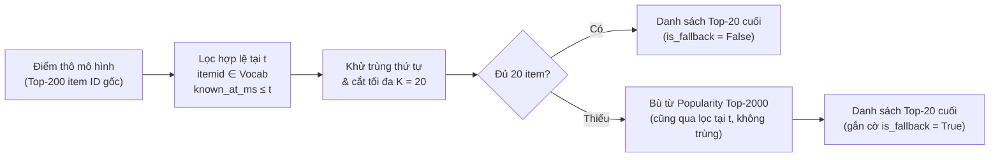
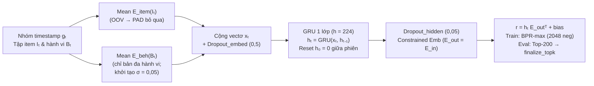

# Phương pháp, Kiến trúc Mô hình và Quy trình Thực nghiệm

Tài liệu này trình bày đầy đủ cơ sở toán học, chi tiết cài đặt thực tế (đối chiếu trực tiếp với `src/rr/` và `configs/protocol.json` **`v1.3.2`**), siêu tham số đã chọn và cơ chế kiểm chứng của tất cả các phương pháp gợi ý theo phiên trong đề tài.

- Tài liệu dữ liệu & tiền xử lý: [`Data.md`](Data.md)
- Tài liệu giao thức đánh giá & kết quả thực nghiệm: [`Đánh giá.md`](<Đánh giá.md>)

---

## 1. Phát biểu bài toán và phạm vi phương pháp (`Protocol v1.3.2`)

### 1.1. Định nghĩa hình thức

Cho một phiên truy cập đang diễn ra đến mốc thời gian $t$, hệ thống quan sát tiền tố gồm $t$ nhóm timestamp liên tiếp:
$$P_q = (g_1, g_2, \dots, g_t), \qquad g_k = \big\{(i_e, b_e) \mid \text{timestamp}(e) = \tau_k\big\}$$
với $i_e \in \mathcal{I}$ là mã sản phẩm và $b_e \in \mathcal{B} = \{\text{view}, \text{addtocart}, \text{transaction}\}$ là loại hành vi. Tại thời điểm $t = \tau_t$, bài toán yêu cầu sinh danh sách có thứ tự gồm $K = 20$ sản phẩm phân biệt $L_q = (\hat{i}_1, \dots, \hat{i}_{20}) \subseteq \mathcal{C}(t)$ để dự đoán tập sản phẩm phân biệt ở nhóm kế tiếp $G_q = \{i_e \mid e \in g_{t+1}\}$ (mọi loại hành vi).

### 1.2. Ba câu hỏi nghiên cứu

- **RQ1 (Đa hành vi):** Phân biệt ba hành vi `view`, `addtocart`, `transaction` có cải thiện chất lượng xếp hạng so với chỉ dùng chuỗi sản phẩm hay coi mọi tương tác như nhau không?
- **RQ2 (Thứ tự tương tác):** Thứ tự diễn biến trong phiên có cung cấp thêm thông tin ngoài độ phổ biến và độ tương đồng sản phẩm không?
- **RQ3 (Đánh đổi thực tiễn):** Phương pháp nào cân bằng tốt nhất giữa chất lượng xếp hạng, chi phí huấn luyện/suy luận trên CPU và khả năng phục vụ phiên ngắn / sản phẩm mới?

### 1.3. Hệ thống mô hình trong phạm vi `v1.3.2`

| Nhóm | Phương pháp | Vai trò | Phạm vi chạy |
| --- | --- | --- | --- |
| **Mốc cơ sở** | **Popularity** | Mốc độ phổ biến & nguồn dự phòng (fallback) | Validation (`NB05`, `NB09`) & Test (`NB10`) |
| **Mốc cơ sở** | **Repeat-last** | Mốc D1 đo trần điểm của hành vi lặp lại | Validation (`NB05`, `NB09`) & Test (`NB10`) |
| **Láng giềng gần** | **ItemKNN** | Đối chứng tương đồng item phi tuần tự | Validation (`NB06`) |
| **Láng giềng gần** | **SKNN → STAN → VSTAN** | Chuỗi phát triển láng giềng phiên; **VSTAN** là mốc kNN chính | `SKNN/STAN` ở `NB06`; **VSTAN** ở `NB06`, `NB09`, `NB10` |
| **Mô hình chính** | **GRU4Rec gốc (`gru4rec_item`)** | Mạng hồi quy theo nhóm timestamp, chỉ dùng item | Validation (`NB09`) & Test (`NB10`) |
| **Mô hình chính** | **GRU4Rec đa hành vi (`gru4rec`)** | Cùng kiến trúc bản gốc, cộng embedding hành vi | Validation (`NB07`, `NB09`) & Test (`NB10`) |

> **Minh bạch thay đổi phạm vi:** So với giai đoạn khảo sát đầu (`v1.2.0`), **SR-GNN** được gỡ ở `v1.3.1` (26/11/2026) và **S-POP, SR, V-SKNN** được gỡ ở `v1.3.2` (26/11/2026) cùng ngưỡng $K = 10$ để tập trung sâu vào trục so sánh trọng tâm **GRU4Rec gốc vs GRU4Rec đa hành vi** trên hai ngưỡng phiên **30 phút và 60 phút** tại $K = 20$.

---

## 2. Cơ chế hậu xử lý chung: Lọc ứng viên và Fallback (`src/rr/candidates.py`)

Mọi mô hình (cả phi neural lẫn neural) đều xuất ma trận ứng viên đã xếp hạng có chiều rộng `width = 200` (riêng `Repeat-last` là `50`), sau đó đi qua cùng một hàm hậu xử lý `finalize_topk()` để đảm bảo so sánh công bằng tuyệt đối:

- Nguồn fallback là danh sách **Popularity có trọng số tối ưu trên Validation** ($w_{\text{view}} = 1, w_{\text{cart}} = 2, w_{\text{buy}} = 1$), giới hạn quét trong `fallback_top_n = 2000` item đứng đầu để giới hạn bộ nhớ (mọi lần chạy đều kiểm tra `short_lists == 0`, tức 100% truy vấn nhận đủ 20 ứng viên hợp lệ).

---

## 3. Các mốc cơ sở (`src/rr/models.py`, Notebook `05`)

### 3.1. Popularity

Xếp hạng toàn cục các item trên tập huấn luyện theo tổng số tương tác có trọng số hành vi:
$$\text{score}_{\text{Pop}}(i) = \sum_{e \in \mathcal{E}_{\text{fit}},\; i_e = i} w_{b_e}$$
với lưới tìm kiếm trên Validation: $w_{\text{view}} = 1$, $w_{\text{addtocart}} \in \{1, 2, 5, 10\}$, $w_{\text{transaction}} \in \{1, 2, 5, 10\}$. Cấu hình được chọn trên Validation là **`pop_v1_c2_b1`** ($w = (1, 2, 1)$), phá hòa theo `itemid` tăng dần.

### 3.2. Repeat-last (Mốc Quyết định D1)

Gợi ý lại các sản phẩm đã xuất hiện trong tiền tố $P_q$ theo **độ gần đây tuyệt đối**, bỏ qua tần suất cũ. Gọi $d_{\min}(q, i) \ge 0$ là khoảng cách tính theo số nhóm từ lần xuất hiện gần nhất của item $i$ tới nhóm cuối $g_t$ ($d = 0$ nếu $i \in g_t$), và $\text{str}(i) \in \{0, 1, 2\}$ là độ mạnh hành vi lớn nhất của $i$ tại nhóm gần nhất đó (`view = 0 < addtocart = 1 < transaction = 2`). Điểm xếp hạng trong `src/rr/models.py` là:
$$\text{score}_{\text{Rep}}(q, i) = -10 \cdot d_{\min}(q, i) + \text{str}(i)$$
Khoảng cách luôn chi phối hoàn toàn; chỉ khi hai item nằm trong **cùng một nhóm timestamp** thì hành vi mạnh hơn đứng trước, sau đó phá hòa theo `itemid` tăng dần. Nếu tiền tố có ít hơn 20 item phân biệt, các vị trí còn lại được bù bằng Popularity.

---

## 4. Họ phương pháp láng giềng gần (`src/rr/models.py`, Notebook `06` & `09`)

Để kiểm soát thời gian suy luận trên phiên rất dài (D3), mọi bộ chấm kNN chỉ sử dụng tối đa **`max_prefix_groups = 50`** nhóm gần nhất của tiền tố (các nhóm xa hơn có trọng số suy giảm xấp xỉ 0).

### 4.1. ItemKNN đa hành vi

- **Huấn luyện (`fit`):** Dựng ma trận thưa phiên $\times$ item $\mathbf{X}$ từ các phiên huấn luyện có $\ge 2$ item phân biệt. Giá trị ô $(s, i)$ là **trọng số lớn nhất** (`max`, không cộng dồn khi xem lặp trong cùng phiên) của các hành vi mà phiên $s$ thực hiện trên item $i$. Tính độ tương đồng cosine giữa các cột item (đặt đường chéo bằng 0) và giữ Top-$M$ láng giềng gần nhất cho mỗi item:
  $$\text{sim}(i, j) = \frac{\mathbf{X}_{:, i}^\top \mathbf{X}_{:, j}}{\|\mathbf{X}_{:, i}\|_2 \, \|\mathbf{X}_{:, j}\|_2}, \qquad i \neq j$$
- **Chấm điểm (`recommend`):** Biểu diễn tiền tố $P_q$ thành vector trọng số suy giảm theo khoảng cách nhóm $w_q(i) = \gamma^{d(q, i)}$ (với tùy chọn nhân trọng số hành vi) rồi tính tổng điểm:
  $$\text{score}_{\text{ItemKNN}}(q, j) = \sum_{i \in P_q} w_q(i) \cdot \text{sim}(i, j)$$
- **Cấu hình chọn trên Validation:** `M = 200`, `decay = 0.6`, trọng số hành vi **đều** `(1, 1, 1)` (đều tốt hơn trọng số hành vi trên cả `all` lẫn `strong_behavior_targets`).

### 4.2. Chuỗi láng giềng theo phiên: SKNN → STAN → VSTAN

Cả ba biến thể chia sẻ chung kho lưu trữ phiên huấn luyện có $\ge 2$ item phân biệt; với mỗi item $i$, chỉ lập chỉ mục tối đa **`sample_size = 500`** phiên kết thúc gần nhất chứa $i$ để tìm tập phiên láng giềng ứng viên $\mathcal{S}(q)$, sau đó chọn Top-$k$ phiên giống nhất $N_k(q)$.

1. **SKNN (Session-KNN nhị phân):**
   - Trọng số truy vấn đồng đều $w_q(i) = 1$ với $i \in P_q$. Độ tương đồng giữa truy vấn $q$ và phiên $s$:
     $$\text{sim}_{\text{SKNN}}(q, s) = \frac{\sum_{i \in P_q \cap s} w_q(i)}{\|w_q\|_2 \sqrt{|s|}}$$
   - Tổng hợp điểm ứng viên: $\text{score}_{\text{SKNN}}(q, j) = \sum_{s \in N_k(q),\; j \in s} \text{sim}_{\text{SKNN}}(q, s) \cdot w_b(j, s)$.
   - *Cấu hình chọn:* `k = 200`, `sample_size = 500`, trọng số đều `(1, 1, 1)`.

2. **STAN (Sequence and Time Aware Neighborhood — Garg et al., 2019):**
   Bổ sung 3 hệ số suy giảm hàm mũ vào SKNN:
   - **Vị trí trong prefix ($\lambda_1$):** $w_q(i) = \exp\!\big(-d_q(i) / \lambda_1\big)$ (item gần thời điểm $t$ có trọng số lớn hơn).
   - **Độ mới của phiên láng giềng ($\lambda_2$):** nhân độ tương đồng với $\exp\!\big(-\max(t_q - t_{\text{end}}(s), 0) / \lambda_2\big)$.
   - **Vị trí trong phiên láng giềng ($\lambda_3$):** gọi $g_{\text{match}}(q, s)$ là chỉ số nhóm trong phiên $s$ của item chia sẻ gần cuối prefix nhất; trọng số đóng góp của ứng viên $j \in s$ nhân thêm $\exp\!\big(-|g_s(j) - g_{\text{match}}(q, s)| / \lambda_3\big)$.
   - *Cấu hình chọn:* `k = 200`, `sample_size = 500`, $\lambda_1 = 1{,}0$, $\lambda_2 = 7\text{ ngày}$ (`604.800.000 ms`), $\lambda_3 = 1{,}0$, trọng số đều `(1, 1, 1)`.

3. **VSTAN (IDF-weighted STAN — mốc kNN chính ở NB09 & NB10):**
   Mở rộng STAN bằng hệ số nghịch đảo tần suất phiên của sản phẩm:
   $$\text{idf}(i) = \ln\!\left(\frac{N_{\text{sessions}}}{\max(\text{df}(i), 1)}\right), \qquad f_{\text{idf}}(i) = \max(\text{idf}(i), 10^{-6})^{\lambda_{\text{idf}}}$$
   Hệ số $f_{\text{idf}}(\cdot)$ được nhân vào **hai vị trí**: (i) trọng số item chia sẻ $i$ trong tử số tính $\text{sim}(q, s)$, và (ii) điểm đóng góp của ứng viên $j \in s$ nhằm ưu tiên sản phẩm đặc trưng thay vì sản phẩm đại trà.
   - *Cấu hình chọn (30' và 60'):* `k = 200`, `sample_size = 500`, $\lambda_1 = 1{,}0$, $\lambda_2 = 7\text{ ngày}$, $\lambda_3 = 1{,}0$, $\lambda_{\text{idf}} = 0{,}5$, trọng số đều `(1, 1, 1)`.

---

## 5. Mô hình chính: GRU4Rec gốc và GRU4Rec đa hành vi (`src/rr/gru.py`, Notebook `07` & `09`)

Cài đặt tự xây dựng bằng PyTorch trên CPU theo đúng tập tính năng chuẩn của bản chính thức **Hidasi & Czapp (RecSys 2023)**, mở rộng để xử lý **nhóm timestamp** và tách trực tiếp nhánh hành vi.

### 5.1. Kiến trúc mạng

- **Biểu diễn đầu vào tại bước $t$:**
  - **GRU4Rec gốc (`gru4rec_item`, `use_behavior = False`):**
    $$\mathbf{x}_t = \frac{1}{|I_t^{\text{in}}|} \sum_{i \in I_t^{\text{in}}} \mathbf{E}_{\text{item}}[i]$$
    Các item ngoài vocabulary ánh xạ sang `PAD` và bị bỏ qua khỏi phép tính trung bình.
  - **GRU4Rec đa hành vi (`gru4rec`, `use_behavior = True`):**
    $$\mathbf{x}_t = \frac{1}{|I_t^{\text{in}}|} \sum_{i \in I_t^{\text{in}}} \mathbf{E}_{\text{item}}[i] + \frac{1}{|B_t|} \sum_{b \in B_t} \mathbf{E}_{\text{beh}}[b]$$
    với $B_t$ là tập hành vi phân biệt trong nhóm $g_t$ (`EmbeddingBag(3, d, mode="mean")`). Nếu nhóm $g_t$ chỉ có item OOV, nhánh hành vi vẫn giữ lại thông tin hành vi.
- **Chuẩn hóa thang khởi tạo (bản vá 25/11/2026):** Khởi tạo cả $\mathbf{E}_{\text{item}}$ và $\mathbf{E}_{\text{beh}}$ theo cùng phân phối $\mathcal{N}(0, 0{,}05^2)$ (`bias = 0`), khắc phục lỗi mặc định PyTorch $\mathcal{N}(0, 1)$ ở `EmbeddingBag` khiến tín hiệu hành vi lấn át item embedding ở các epoch đầu (được khóa bằng unit test `test_behavior_embedding_same_scale_as_items`).
- **Constrained Embedding:** Chia sẻ trực tiếp ma trận trọng số đầu vào và đầu ra ($\mathbf{E}_{\text{out}} = \mathbf{E}_{\text{in}} \in \mathbb{R}^{|\mathcal{V}| \times h}$, chiều embedding bằng đúng kích thước ẩn $h = 224$, lớp chiếu `proj = Identity()`), giúp giảm một nửa bộ nhớ tham số và nâng cao chất lượng biểu diễn cho item ít gặp.
- **Cửa sổ huấn luyện (D3):** Phiên dài hơn `max_len = 51` nhóm được cắt thành các cửa sổ tối đa 51 nhóm (chồng nhau 1 nhóm để không mất bước chuyển tiếp ở biên cửa sổ), reset trạng thái ẩn $\mathbf{h}_0 = \mathbf{0}$ ở đầu mỗi phiên/cửa sổ. Khi suy luận đánh giá (`query_states(..., mode="sequential")`), mạng chạy toàn bộ chiều dài phiên không cắt.

### 5.2. Lấy mẫu âm dùng chung và hàm mất mát (D4)

Trong mỗi mini-batch gồm $B$ cửa sổ (gom theo độ dài gần nhau — length-bucketing), tập ứng viên $\mathcal{C}_{\text{batch}}$ là hợp duy nhất của tất cả target dương trong batch và $n_{\text{neg}} = 2.048$ mẫu âm dùng chung rút theo phân phối độ phổ biến lũy thừa:
$$p(j) = \frac{\text{count}(j)^{\alpha}}{\sum_{u \in \mathcal{V}} \text{count}(u)^{\alpha}}, \qquad \alpha = \text{sample\_alpha}$$
Nhờ khử trùng hợp nhất, mẫu âm ngẫu nhiên trùng với target dương của một bước sẽ tự động được loại khỏi tập mẫu âm của bước đó (không tính phạt nhầm). Với target nhiều item ($|G| > 1$), trọng số bước chia đều $w_i = 1/|G|$.

Hai hàm mất mát được đối chứng trực tiếp trên Validation (NB07):

1. **Sampled Softmax Cross-Entropy (có hiệu chỉnh log-Q):**
   $$\tilde{r}_j = r_j - \ln \max(p(j), 10^{-12}), \qquad \mathcal{L}_{\text{CE}} = -\frac{1}{|G|} \sum_{i \in G} \ln \frac{e^{\tilde{r}_i}}{\sum_{j \in \mathcal{C}_{\text{batch}}} e^{\tilde{r}_j}}$$
2. **BPR-max (Hidasi & Karatzoglou, CIKM 2018 — hàm mất mát được chọn):**
   Điểm ứng viên đi qua kích hoạt phi tuyến $\hat{r}_j = \text{ELU}(r_j; \alpha_{\text{elu}} = 0{,}5)$. Với từng bước có tập target dương $G$ và tập mẫu âm $\mathcal{N} = \mathcal{C}_{\text{batch}} \setminus G$, tính trọng số softmax trên mẫu âm $s_j = \frac{e^{\hat{r}_j}}{\sum_{u \in \mathcal{N}} e^{\hat{r}_u}}$ (đặt $s_i = 0$ với $i \in G$) và tối thiểu hóa:
   $$\mathcal{L}_{\text{BPR-max}} = \frac{1}{|G|} \sum_{i \in G} \left[ -\ln\!\left(\sum_{j \in \mathcal{N}} s_j \, \sigma(\hat{r}_i - \hat{r}_j) + 10^{-24}\right) + \lambda_{\text{bpreg}} \sum_{j \in \mathcal{N}} s_j \, \hat{r}_j^2 \right]$$
   Trọng số $s_j$ tập trung gradient vào các **mẫu âm khó** có điểm cao, còn số hạng $\lambda_{\text{bpreg}} \sum s_j \hat{r}_j^2$ ngăn điểm mẫu âm trôi về vô cực.

### 5.3. Bảng siêu tham số đã chọn, đặt cạnh paramfile của bản chính thức

| Tham số / Thiết kế | Bản dự án (`src/rr/gru.py`, NB07 & NB09) | Paramfile RetailRocket của bản chính thức (`hidasib/GRU4Rec_PyTorch_Official`) |
| --- | --- | --- |
| Đơn vị đầu vào | Nhóm `(session_id, timestamp)` (mean embedding) | Từng sự kiện riêng lẻ |
| Nhánh hành vi | `gru4rec_item` (không) vs `gru4rec` (có `EmbeddingBag`) | Không có (chỉ item) |
| Kiến trúc mạng | 1 lớp GRU, `hidden = 224`, `constrained = True` | 1 lớp GRU, `layers = [224]`, `constrained_embedding = True` |
| Hàm mất mát | `bpr-max` (`elu = 0.5`, `bpreg = 1.0`) | `bpr-max` (`elu_param = 0.5`, `bpreg = 1.95`) |
| Lấy mẫu âm | `n_neg = 2048`, `sample_alpha = 0.5` | `n_sample = 2048`, `sample_alpha = 0.4` |
| Dropout | `dropout_embed = 0.5`, `dropout = 0.05` | `dropout_p_embed = 0.5`, `dropout_p_hidden = 0.05` |
| Tối ưu hóa & batch | `SparseAdam` (emb/bias) + `Adam` (GRU), `lr = 0.002`, `batch = 80` | `Adagrad` với `lr = 0.05`, `momentum = 0.4`, `batch = 80` |
| Cắt phiên dài khi train | Cửa sổ 51 nhóm chồng 1 nhóm (D3) | Không cắt phiên |
| Số epoch chọn trên Val | **2 epoch** (early stopping theo `NDCG@20` ở cả 30' & 60') | **10 epoch** (paramfile `retailrocket_bprmax_shared_best`) |

### 5.4. Lưu trữ cấu hình và trọng số mô hình (`models/`)

Chỉ tệp cấu hình `config.json` được theo dõi trên Git; tệp trọng số `model.pt` (~193 MB/mô hình) bị bỏ qua bởi `.gitignore` và có thể tái tạo bằng cách chạy lại notebook tương ứng:

| Thư mục (`models/`) | Mô hình | Ngưỡng phiên | Do notebook sinh ra |
| --- | --- | :---: | :---: |
| `models/gru4rec/` | GRU4Rec đa hành vi (`item + behavior`) | 30 phút | `07` |
| `models/gru4rec_item/` | GRU4Rec gốc (`chỉ item`) | 30 phút | `09` |
| `models/session60/gru4rec/` | GRU4Rec đa hành vi (`item + behavior`) | 60 phút | `09` |
| `models/session60/gru4rec_item/` | GRU4Rec gốc (`chỉ item`) | 60 phút | `09` |

- Toàn bộ 4 thư mục trên chỉ lưu mô hình huấn luyện trên tập **`train`**. Biến thể refit trên `train + validation` (D2) được huấn luyện trực tiếp trong notebook `10` và không ghi đè vào `models/`.
- `Popularity`, `Repeat-last`, `ItemKNN` và `VSTAN` không lưu trọng số ra `models/` vì có thể tính lại trực tiếp từ tập huấn luyện trong vài giây mỗi lần chạy.
- `SR-GNN` đã được gỡ khỏi phạm vi từ protocol `v1.3.1` nên không còn thư mục `models/srgnn/`.

---

## 6. Quy trình đóng băng, Refit (D2) và Thiết kế Ablation

1. **Đóng băng cấu hình trước Test (NB10):** Ghi SHA-256 của `configs/protocol.json`, toàn bộ report validation (`05–09`) và trọng số 4 mô hình GRU đã chọn vào `reports/10_final/frozen.json`. Bắt buộc chạy diễn tập trên validation (`RR_FINAL_SPLIT=validation` → `reports/10_final_rehearsal/`) khớp tuyệt đối trước khi mở khóa lần chạy Test duy nhất.
2. **Hai biến thể huấn luyện trên Test (D2):**
   - `train_only`: dùng mô hình đã fit trên `train` (vocab `212.915`).
   - `train_validation_refit` (**biến thể chính**): giữ nguyên siêu tham số và số epoch đã chọn trên Validation (`2 epoch` cho GRU4Rec), tính lại vocabulary (`224.167`), `known_at_trainval_ms`, độ phổ biến, kho phiên VSTAN và huấn luyện lại GRU từ đầu trên `train + validation`.
3. **Các phép Ablation có kiểm soát:**
   - **Vai trò thứ tự phiên (NB07 — RQ2):** đánh giá cùng mô hình GRU đã huấn luyện trên (a) tiền tố bị xáo trộn ngẫu nhiên thứ tự nhóm (`shuffled_groups`) và (b) chỉ giữ nhóm cuối cùng (`last_group_only`).
   - **Độ vững dữ liệu (NB12):** (a) gắn cờ visitor bất thường theo phân vị `99,99%` trên train (`> 145,3` sự kiện/ngày hoặc `> 11` giao dịch/ngày UTC) và kiểm tra độ ổn định thứ hạng khi bỏ nhóm này hoặc bỏ top-10 visitor; (b) ma trận 2×2 `gốc/gộp` khi gộp các nhóm liên tiếp trùng hệt tập `(item, hành vi)`.

---

## 7. Tài liệu tham khảo học thuật

1. **Hidasi, B., Karatzoglou, A., Baltrunas, L., & Tikk, D. (2016).** *Session-based Recommendations with Recurrent Neural Networks.* ICLR 2016.
2. **Jannach, D., Ludewig, M., & Lerche, L. (2017).** *Session-based item recommendation in e-commerce: on short-term intents, reminders, trends and discounts.* UMUAI, 27(3–5), 351–392.
3. **Hidasi, B., & Karatzoglou, A. (2018).** *Recurrent Neural Networks with Top-k Gains for Session-based Recommendations.* ACM CIKM 2018.
4. **Ludewig, M., & Jannach, D. (2018).** *Evaluation of Session-based Recommendation Algorithms.* UMUAI, 28(4–5), 331–390.
5. **Garg, D., Gupta, P., Malhotra, P., Vig, L., & Shroff, G. (2019).** *Sequence and Time Aware Neighborhood for Session-based Recommendations: STAN.* ACM SIGIR 2019.
6. **Ren, P., Chen, Z., Li, J., Ren, Z., Ma, J., & de Rijke, M. (2019).** *RepeatNet: A Repeat Aware Neural Recommendation Machine for Session-based Recommendation.* AAAI 2019.
7. **Ludewig, M., Mauro, N., Latifi, S., & Jannach, D. (2021).** *Empirical analysis of session-based recommendation algorithms.* UMUAI, 31, 149–181.
8. **Latifi, S., Mauro, N., & Jannach, D. (2021).** *Session-aware recommendation: A surprising quest for the state-of-the-art.* Information Sciences, 573, 291–315.
9. **Hidasi, B., & Czapp, Á. T. (2023).** *The effect of third party implementations on reproducibility* & *Widespread flaws in offline evaluation of recommender systems.* ACM RecSys 2023.
10. **Shehzad, F., & Jannach, D. (2024).** *Performance comparison of session-based recommendation algorithms based on GNNs.* ECIR 2024.
